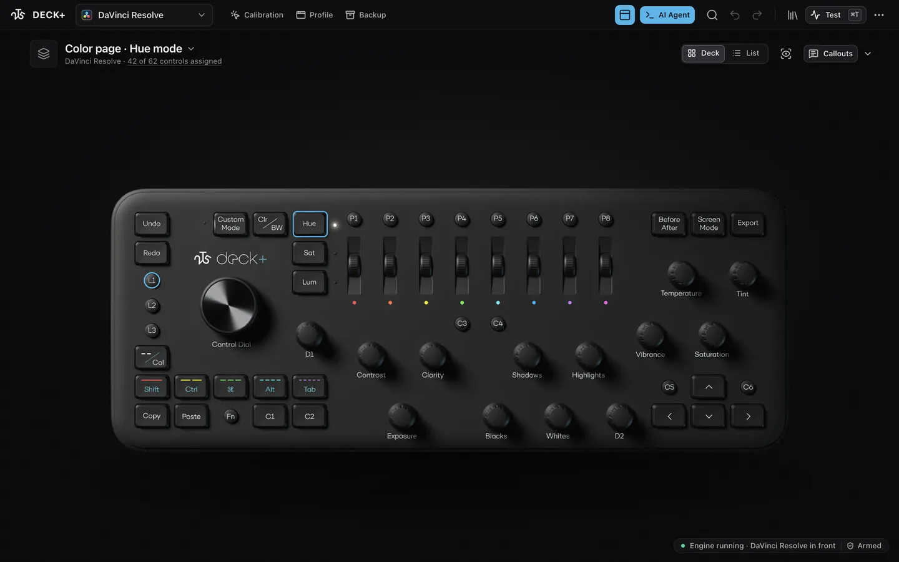

<p align="center">
  <picture>
    <source media="(prefers-color-scheme: dark)" srcset="docs/screenshots/2t5-logo-light.png">
    
  </picture>
</p>

# 2T5 DECK+

**by 2T5 Film.** A free, open-source Mac app that turns a Loupedeck+ into one deck for every app: whatever app is in front, the deck switches to that app's controls.

<p align="center">
  
</p>

We built it in our own grading suite and share it freely.

## What it does

- **Follows the app in front.** Switch apps and the deck switches its controls with you. Each app gets its own preset; anything you leave unset falls back to the Global one.
- **Map any app yourself.** An editor on a real image of your deck, with starter templates (Chrome, Safari, Blender, Photoshop, Terminal and more).
- **Feel every knob.** Live visuals for keys and knobs, and a sensitivity curve you can tune per control. Every control is assignable in the editor.
- **A DaVinci Resolve preset** with an on-screen HUD, Clean Feed on/off and color controls (Resolve's external scripting must be switched on).
- **Your AI agent can set it up.** AI access is off until you switch it on. An agent (Claude Code, Codex, Gemini CLI, Cursor, anything that speaks MCP) can then assign controls for you; every change is one undo step. See [AGENTS.md](AGENTS.md).
- **Safe by design.** It starts disarmed on first launch, so nothing fires until you arm it. You can also put a "Panic: disarm the deck" action on a spare button (it is not assigned by default).

More in the app itself: [docs/ai-access.md](docs/ai-access.md) is the full reference for AI access.

## Requirements

The app checks all of this itself and lists anything missing in its **Requirements** panel (the `...` menu, or the status pill at the bottom). Nothing needs an internet connection. The list below comes from [docs/dependencies.json](docs/dependencies.json), the one file the app, this README and the website share.

<!-- deps-table:start -->
| Needs | | For | How to get it |
|---|---|---|---|
| macOS 11 (Big Sur) or later | **Required** | Everything | Update in System Settings > General > Software Update. |
| Apple Silicon Mac (M1 or newer) | **Required** | Everything | Use an M1 or newer Mac. The app is built for Apple Silicon only. |
| Loupedeck+ plugged in | **Required** | The deck itself | Plug the Loupedeck+ into the Mac with its USB cable, straight into the Mac if a hub drops it. Other Loupedeck models are not supported. |
| No other app driving the same deck | **Required** | The deck itself | Quit the Loupedeck software and any other MIDI mapper (Bome MIDI Translator, MidiKey2Key, the old LD-RESOLVE) from their own app menu. Never force-quit them. |
| Accessibility permission | **Required** | Keys, clicks and scrolling | System Settings > Privacy & Security > Accessibility: switch 2T5 DECK+ on. If it is already on, switch it off and on again, then restart the app. |
| Screen Recording permission | Optional | Reading what is on screen: HUD placement, mouse calibration, window titles | System Settings > Privacy & Security > Screen & System Audio Recording: switch 2T5 DECK+ on, then restart the app. |
| Automation permission for Finder | Optional | Finder tag keys | macOS asks the first time a Finder tag key is used. If you said No: System Settings > Privacy & Security > Automation, then allow 2T5 DECK+ to control Finder. |
| macOS 15.2 or later | Optional | Mouse calibration: the picture check that notices a changed Resolve layout | Update in System Settings > General > Software Update. |
| Python 3 | Optional | DaVinci Resolve control | Install Python 3 from python.org, or with Homebrew. Nothing else to install: the Resolve helper only uses what Python ships with. |
| DaVinci Resolve (Studio) | Optional | DaVinci Resolve control | Install DaVinci Resolve Studio from Blackmagic Design. Its scripting files come with it. Tested with Studio only: the free version may refuse outside scripting. |
| Resolve: External scripting set to Local | Optional | DaVinci Resolve control | Open Resolve, then DaVinci Resolve > Preferences > System > General > External scripting using: Local. Keep Resolve running. |
| Programs your Run command keys call | Optional | Keys you set to run a command | Install whatever program the command starts. The built-in actions need nothing extra. |
<!-- deps-table:end -->

Logitech stopped selling the Loupedeck line in March 2025, so in practice this is for people who already own a Loupedeck+ or buy one second-hand.

**Run one deck app at a time.** If the Loupedeck software or any other mapper is driving the same deck, quit it first: two apps answering one deck will both react to every press.

## Install

1. Download the latest `2T5-DECK-plus-…-macos-arm64.zip` from the [Releases](../../releases) page and unzip it.
2. Drag **2T5 DECK+.app** into your Applications folder.
3. Open it. **The first time, macOS will stop it** because the app is signed with our own developer certificate, not an Apple-notarised one. This is expected, you only do it once:
   1. Open **System Settings > Privacy & Security**.
   2. Scroll down to the message about "2T5 DECK+" and click **Open Anyway**.
   3. Confirm with your password or Touch ID, then open the app again.

   On macOS 14 and earlier, Control-click (right-click) the app, choose **Open**, then **Open** again. On macOS 15 and later that shortcut no longer works; use Open Anyway as above.

   Prefer the Terminal? This removes the download flag from the app instead:

   ```
   /usr/bin/xattr -dr com.apple.quarantine "/Applications/2T5 DECK+.app"
   ```
4. Grant **Accessibility** when asked (System Settings > Privacy & Security > Accessibility). If the switch looks on but nothing fires, turn it off and on again and restart the app.
5. The app starts **disarmed**. Look around, set up your controls, then click **Armed** in the bottom corner (or press Cmd+K) when you want the deck to act. The status popover has a "Ready to go?" checklist.

## Using it

- The top-left menu switches between **Global** and your apps. **Add app** offers starter presets or captures the app in front.
- Click any control on the deck image to see and change what it does. **Test** (Cmd+T) shows what the deck sends, live, without firing anything while the editor is in front.
- **Calibration** teaches the mouse-driven Resolve sliders where they are on your screen.
- **Backup** exports and restores your presets as one file.

## For AI agents

This repository ships a manual written for agents: [AGENTS.md](AGENTS.md). It covers switching AI access on, the 13 tools and the terminal command, what an agent can and cannot do, and how to work safely with a person's deck.

## Build from source

You need Go 1.26, [Wails v2](https://wails.io) (v2.12), Node, and Xcode command line tools.

```
git clone https://github.com/tunahanemre/2t5-deck-plus.git
scripts/build-app.sh          # builds, signs, and installs to /Applications by default
```

`scripts/build-app.sh` signs with a local code-signing certificate named `2T5 DECK+ Dev`. Create one in Keychain Access (Certificate Assistant > Create a Certificate, type Code Signing) or change `CERT_NAME` in the script. A stable certificate keeps your Accessibility grant across rebuilds. Environment: `DECKPLUS_NO_INSTALL=1` builds without installing, `DECKPLUS_INSTALL_PATH` installs elsewhere.

`scripts/release-zip.sh` builds the same bundle and zips it for a release.

To try the editor without a deck, run the dev server. It opens no MIDI port and arms nothing:

```
go run ./cmd/deck-editor-dev --static app/frontend/public/editor --sim
# then open http://127.0.0.1:2541/
```

## Support

Questions, bugs and ideas: [GitHub Issues](../../issues). Please say which Mac, which macOS and which app was in front.

## Support the project

2T5 DECK+ is free. If it saves you time and you want to help us keep building tools like it, you can [donate](https://github.com/sponsors/tunahanemre).

## Credits

Made by [2T5 Film](https://2t5.co). Built with [Wails](https://wails.io). Icons: see `app/frontend/public/editor/assets/icons/ICONS-LICENSE.txt`.

## License

MIT, see [LICENSE](LICENSE). Copyright (c) 2026 2T5 Film.
